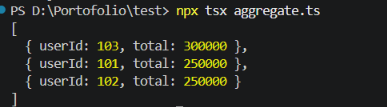

# Aggregate Transactions

Fungsi TypeScript untuk menghitung total transaksi per pengguna, lalu mengurutkannya dari total terbesar. Jika total sama, pengguna diurutkan berdasarkan `userId` terkecil.


```bash
npx tsx aggregate.ts
```

## Hasil

```
[
  { userId: 103, total: 300000 },
  { userId: 101, total: 250000 },
  { userId: 102, total: 250000 }
]
```

